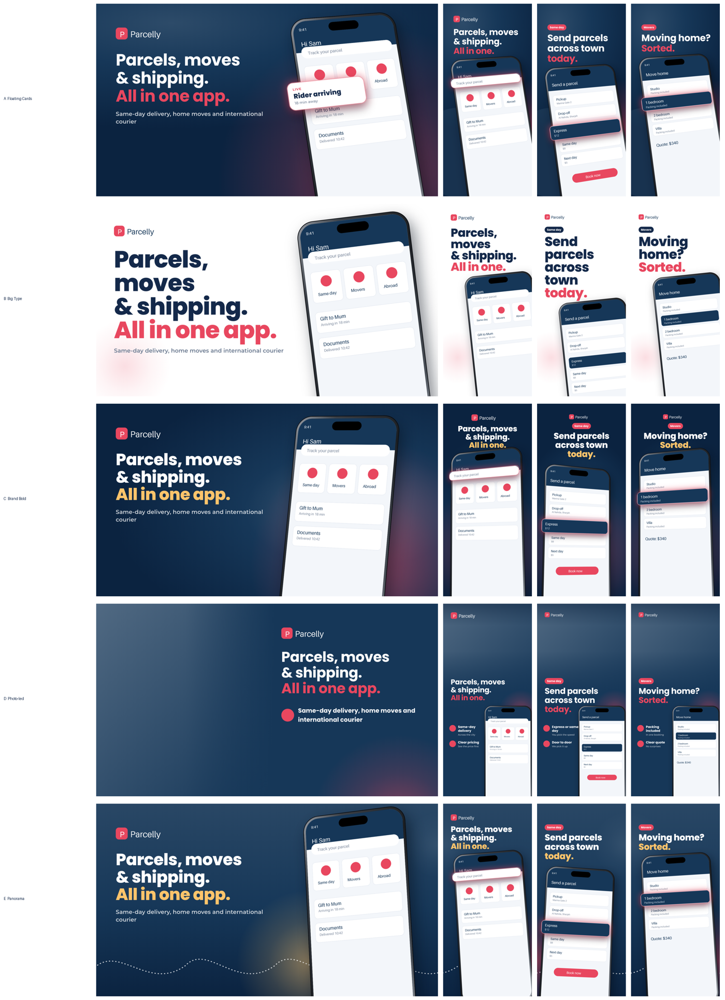

# ASO Screenshot Studio

A Claude Code skill that designs **App Store and Google Play screenshots** for any app.

Give it an app name, the website and a store link, plus any design language you have (Figma link, brand guidelines, logo, brand shapes, photos). It reads the listing and the brand, writes the screenshot copy, shows you **5 design directions**, and once you pick one for iOS and one for Android, renders the full set as upload-ready PNGs plus a review PDF.



## What you get
| Store | Asset | Size |
|---|---|---|
| App Store | 6–7 screenshots, iPhone 6.9″ | 1290 × 2796 |
| App Store | 6–7 screenshots, iPhone 6.5″ | 1242 × 2688 |
| Google Play | 6–7 phone screenshots | 1080 × 1920 |
| Google Play | Landscape lead screenshot | 1920 × 1080 |
| Google Play | Feature graphic | 1024 × 500 |

Five directions: **A Floating Cards** (3D phone, real UI popping out as glowing cards) · **B Big Type** · **C Brand Bold** · **D Photo-led** · **E Panorama** (one scene flowing across the landscape lead and every screenshot).

## Install
Requirements: [Claude Code](https://claude.com/claude-code), Google Chrome or Chromium, Python 3.8+, Pillow.

```bash
git clone https://github.com/arnabsubscribe-cmd/aso-screenshot-studio ~/.claude/skills/aso-screenshot-studio
```
```bash
pip3 install pillow
```

Then in Claude Code, ask: *"Make App Store screenshots for my app"* (or type `/aso-screenshot-studio`). Claude asks for the app name, website and store links, and takes it from there.

## Try the demo without Claude
```bash
cd ~/.claude/skills/aso-screenshot-studio && python3 examples/demo/make_demo_assets.py
```
```bash
python3 scripts/render.py options examples/demo/config.json /tmp/aso-demo
```
```bash
python3 scripts/render.py build examples/demo/config.json /tmp/aso-demo --ios floating --android bigtype
```

## How it works
- `scripts/fetch_store.py` reads the Google Play page and the App Store (iTunes Lookup API) plus the website's colours, fonts and logo candidates.
- Claude writes a `config.json` (brand tokens, screens, 6–7 frames of copy). Schema: [`references/config.md`](references/config.md).
- `scripts/render.py` loads `engine/engine.js` in headless Chrome and screenshots each frame at exact store sizes.

Nothing is hard-coded to one brand: colours, fonts, logo and the background motif (`glow`, `blob`, `ring`, `dots`, `arc`, `none`, or your own brand shape) all come from your design language.

Tips: give it **raw app screens** (not the existing marketing screenshots) for the best result, and only put figures on cards that the app owner has confirmed. See [`references/copy-and-specs.md`](references/copy-and-specs.md).

## License
MIT. Store screenshots, logos and photos you feed in belong to their owners.
